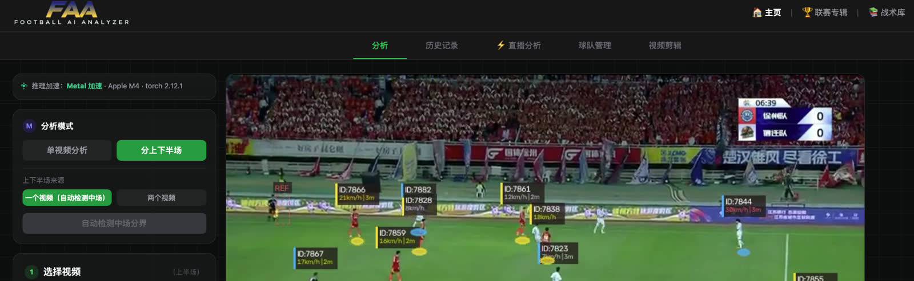
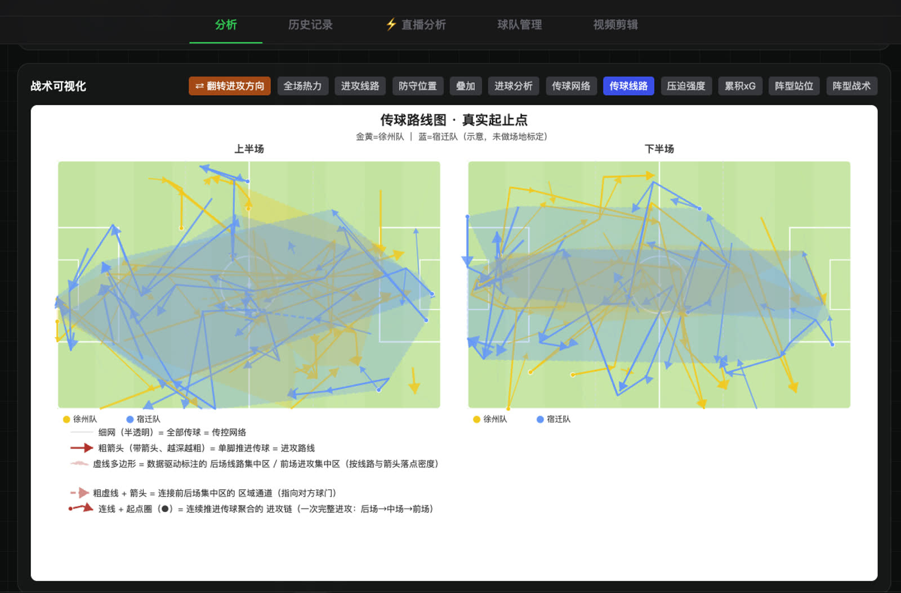
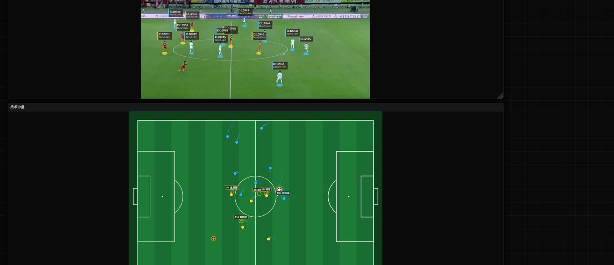
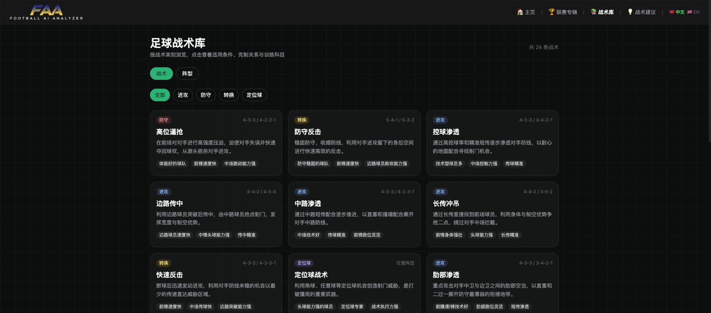
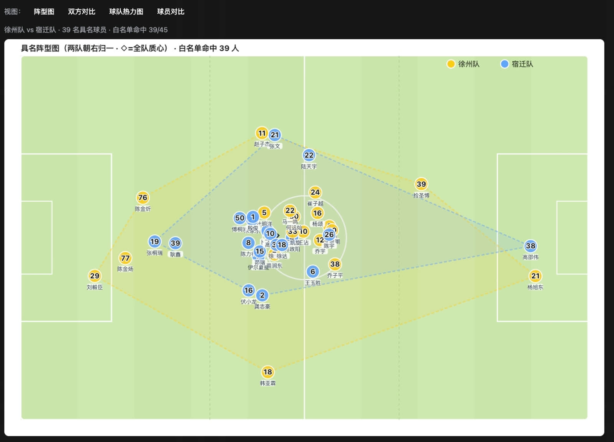
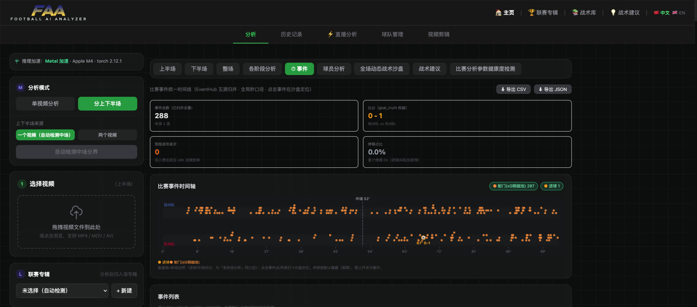
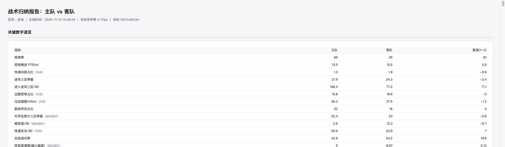
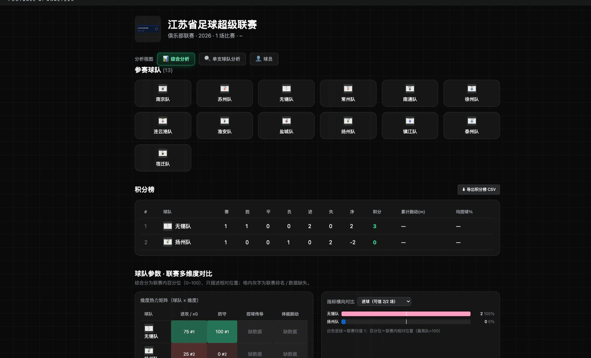

# FAA — Football AI Analyzer

**One camera feed in. A complete tactical dossier out.**

Single-view football video analysis with no multi-camera rig and no manual pitch calibration.
Broadcast footage, stream capture or a local recording is enough to produce a full set of
reusable tactical assets.

> Live product site: **https://sportai-hq.pages.dev**
> Product brief (PDF): **[中文](https://sportai-hq.pages.dev/assets/files/faa-intro.pdf)** · **[English](https://sportai-hq.pages.dev/assets/files/faa-intro-en.pdf)**

---

## What this repository is — and what it is not

This is a **capability showcase**. It exists so that technical evaluators, analysts and
acquisition-side reviewers can see *what the system produces* and decide whether it is worth a
deeper conversation.

**It contains no implementation.** There is no source code here, no model weights, no training
data, no configuration, and no inference pipeline. That is deliberate, not an oversight:

- the implementation is under IP protection, with software copyright registration in progress;
- commercial discussions (licensing and acquisition) are active, and publishing the method
  would damage the position of every party involved;
- an accurate description of the method is available to qualified parties **under NDA**, in a
  private repository — see [How to evaluate it](#how-to-evaluate-it).

If you arrived expecting to `git clone` and run it: you cannot, by design. What you *can* do is
open the live site, read the sample report, and ask for a proof-of-concept on your own match.

---

## What the system does

| Stage | What it accepts / produces |
|---|---|
| **Input** | One video source: TV broadcast, stream screen capture, or a local recording file. No additional cameras, no manual pitch calibration, no operator marking events by hand. |
| **Normalisation** | Every player, the ball and every event are mapped into a single metric coordinate system (a 105 × 68 m pitch), so views from different matches become directly comparable. |
| **Output** | 9 analysis views · 12 overlay views · a 24-entry named tactics library across four families (attack, defence, transition, set pieces) · a 3D tactical sandbox scrubable at 0.5–4× speed · an event timeline · a bilingual PDF/HTML tactical report in which every claim links back to the original video frame. |

Deployment is local-first: the pipeline runs on an ordinary workstation (macOS supported),
and raw footage does not have to leave the machine. Delivery options beyond that are
discussed per deal.

### Screenshots

| | |
|---|---|
|  |  |
| **9 analysis views from one feed** | **12 overlay views on a normalised pitch** |
|  |  |
| **3D tactical sandbox, 0.5–4× scrub** | **24-entry named tactics library** |
|  |  |
| **Named player output** | **Event timeline, frame-addressable** |
|  |  |
| **Bilingual report with frame back-links** | **League-level album across 13 teams** |

---

## What is deliberately excluded

For anyone auditing this repository, here is the exclusion list, stated plainly:

- source code of any kind, including build scripts and internal tooling;
- model weights, checkpoints, exported graphs and inference engines;
- training, validation and annotation datasets;
- the method documents that specify how registration, tracking, team assignment and tactic
  detection are implemented;
- customer names, contracts, pricing, and any commercial terms;
- server credentials, deployment scripts and infrastructure configuration.

The `docs/` folder describes **module boundaries and evaluation criteria only**. It does not
describe algorithms, parameters or model architecture, and it is written to stay that way.

---

## How to evaluate it

Three routes, in increasing depth. Choose the one that matches how much you need to know.

**1. Public — no commitment.**
Read the site and the sample report. Every number in the report is traceable to a frame; if a
figure is a modelled estimate rather than a measurement, it is labelled as such in the document.
That labelling discipline is itself part of what we are asking you to judge.

**2. Proof of concept — one match, 48 hours.**
Send one match video (your footage, or a public broadcast you have the right to use). Within
48 hours you receive the full output set for that match, free, once. It is watermarked
`POC · non-production` and cannot be redistributed. You keep the report; we keep nothing.
This is the fastest way to find out whether the output is usable for your coaches, your
analysts or your product line.

**3. Under NDA — the method.**
For licensing or acquisition diligence, we open a **private** repository containing the
implementation, and grant time-limited read access to named individuals. Scope, duration and
revocation are agreed before access is granted. Architecture walkthroughs and accuracy
discussions happen in the same session — see [docs/verification.md](docs/verification.md).

---

## Commercial tracks

Two tracks are open, and they are not mutually exclusive.

**Usage rights** — for clubs, federations, leagues, broadcasters, media and academies:
seat licence (analyst workstations), per-match analysis service, or white-label / API
integration into an existing platform.

**Ownership** — for sports-data companies, sports-tech vendors, software companies and
investment funds: assignment or exclusive licence of the whole asset, including source code,
trademark and client contracts. Software copyright registration is in progress and is part of
the closing checklist; a transfer of registered software copyright requires a contract
registration with the China Copyright Protection Center, which we will handle as part of the
deal.

---

## Roadmap of this repository

| Version | Date | Change |
|---|---|---|
| v1 | 2026-11 | Initial showcase: capability set, screenshots, evaluation routes |

This repository will grow with **evidence**, not with code: sample reports, methodology notes
on how accuracy is measured, and eventually a redacted evaluation package in Releases.

---

## Contact

**jov611@gmail.com** · https://sportai-hq.pages.dev

Please write from a company address and say which track you are asking about (usage or
ownership), so the first reply is the right one.

---

## License

All rights reserved. See [LICENSE](LICENSE). Reading, citing and internally evaluating this
material is permitted; no licence is granted to any implementation, model or dataset, none of
which is present here.
