# FAA — Football AI Analyzer｜足球 AI 智能分析系统

**一段画面进来，一整套战术资产出去。**

单画面足球视频分析：不需要多机位，不需要人工标定球场。
一段转播画面、一次流媒体屏摄，或者一个本地录像文件就够了。

> 产品站点：**https://sportai-hq.pages.dev**
> 产品介绍 PDF：**[中文](https://sportai-hq.pages.dev/assets/files/faa-intro.pdf)** · **[English](https://sportai-hq.pages.dev/assets/files/faa-intro-en.pdf)**
> 产品演示视频（约 4 分半）：**[观看](https://sportai-hq.pages.dev/assets/video/faa-intro-video.mp4)**

[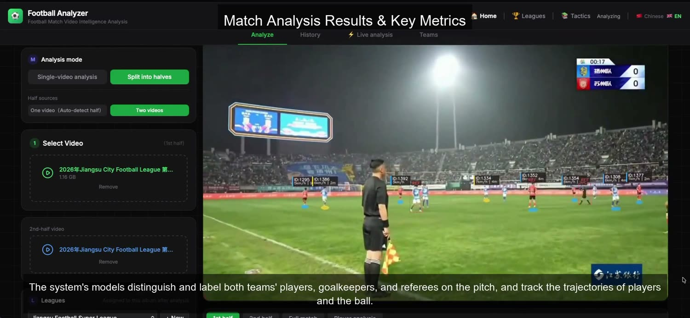](https://sportai-hq.pages.dev/assets/video/faa-intro-video.mp4)

*上面这一帧取自演示视频——一场从单一转播画面分析出来的真实联赛，画面上是逐人编号、速度读数与
队伍归属。*

---

## 这个仓库是什么，不是什么

这是一个**能力展示仓库**。它存在的目的，是让技术评估方、分析师和收购侧审查人能看清
*这套系统产出什么*，从而判断值不值得进下一步沟通。

**这里没有实现代码。** 没有源码、没有模型权重、没有训练数据、没有配置文件，也没有推理
流水线。这是刻意的安排，不是遗漏：

- 实现部分处于知识产权保护之下，软件著作权登记正在办理；
- 授权与受让谈判正在进行，公开实现方法会损害各方地位；
- 方法的完整说明，可向**签署 NDA 的合格方**提供，形式为私有仓库——见[如何评估](#如何评估)。

如果你是想 `git clone` 下来跑一遍：跑不起来，这是设计如此。但你可以打开线上站点、读样本
报告，或者直接要一次基于你自己比赛的 POC。

---

## 这套系统在做什么

| 环节 | 接受 / 产出 |
|---|---|
| **输入** | 单一视频源：电视转播、流媒体屏摄，或本地录像文件。不加机位，不人工标定球场，不靠人工逐帧标记事件。 |
| **统一坐标** | 每名球员、球和每个事件都映射进同一套米制坐标系（105 × 68 米球场），不同比赛、不同机位的视图因此可以直接比较。 |
| **产出** | 9 个分析视图 · 12 种叠加视图 · 24 条具名战术库（进攻 / 防守 / 转换 / 定位球四类）· 可 0.5–4 倍速拖动回看的 3D 战术沙盘 · 事件时间轴 · 中英双语 PDF/HTML 战术报告，其中每条结论都能跳回原始视频帧。 |

部署以本地为先：流水线跑在普通工作站上（支持 macOS），原始视频不必离开本机。
除此之外的交付形态，按项目单独商谈。

### 界面实录

| | |
|---|---|
| 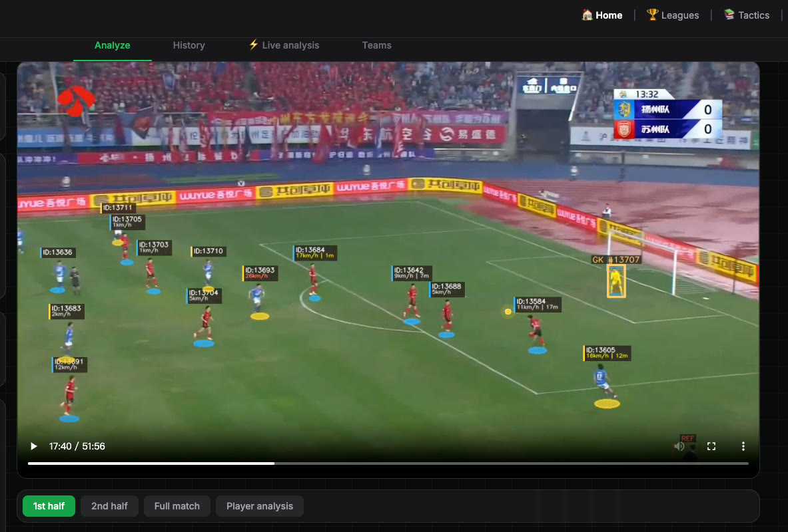 | 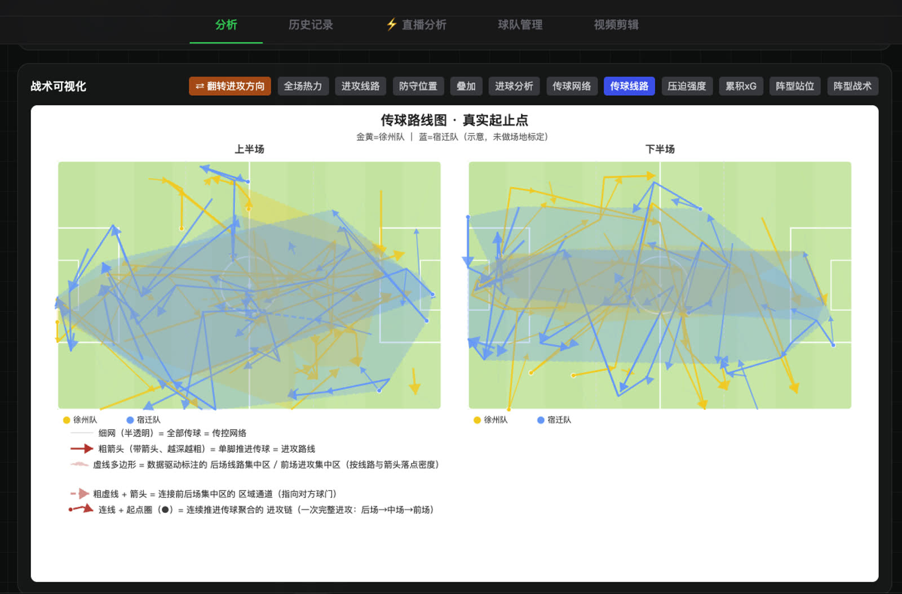 |
| **一段画面进来：球员、门将、裁判逐一追踪** | **统一球场坐标上的 12 种叠加视图** |
| 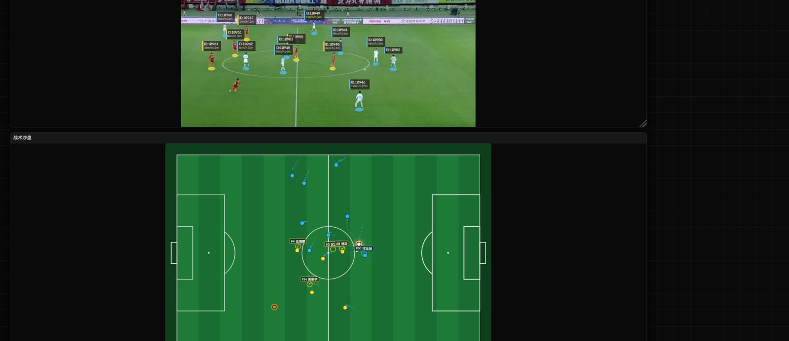 | 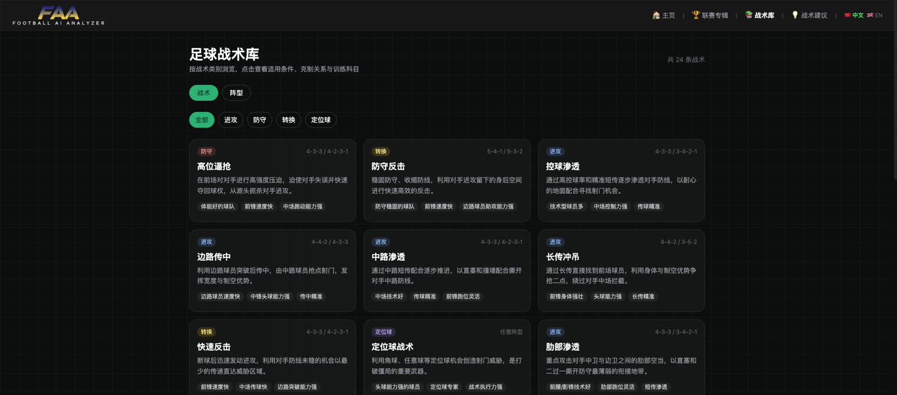 |
| **3D 战术沙盘，0.5–4 倍速** | **24 条具名战术库** |
| 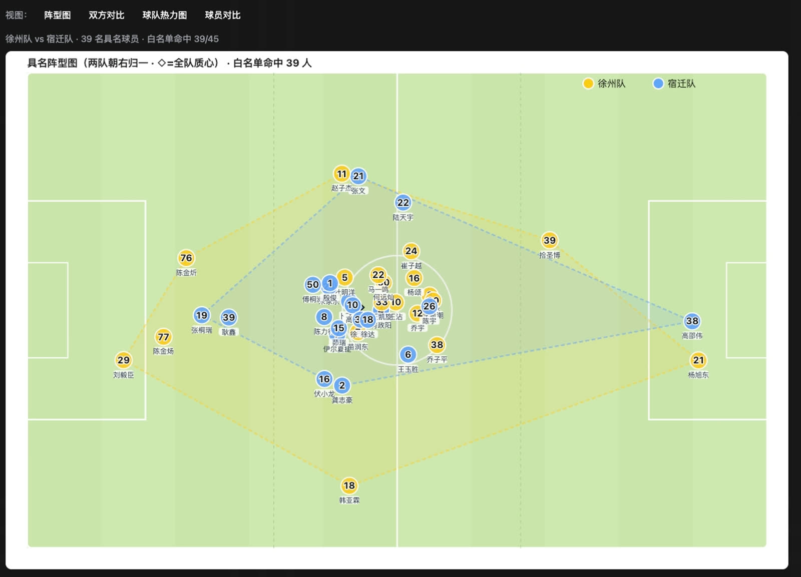 | 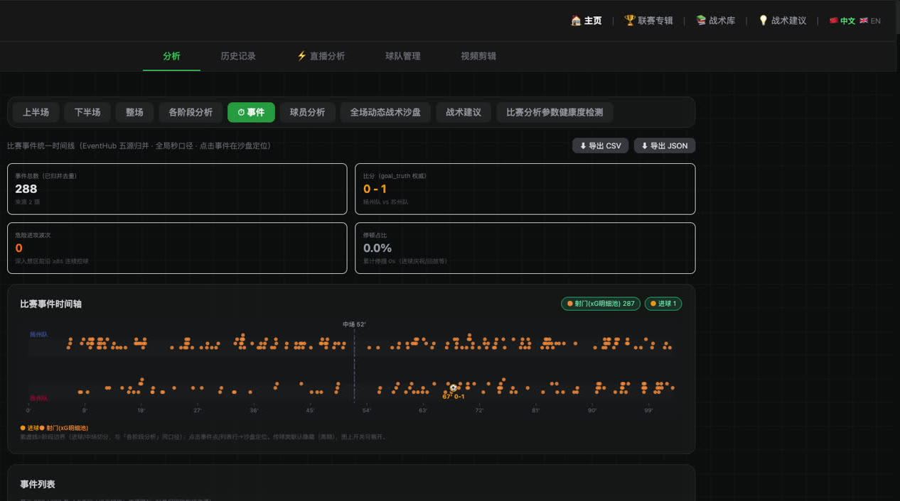 |
| **具名球员输出** | **事件时间轴，可定位到帧** |
| 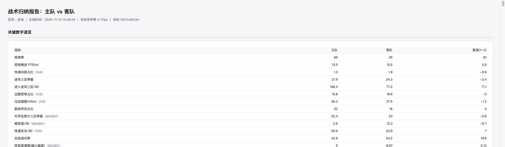 | 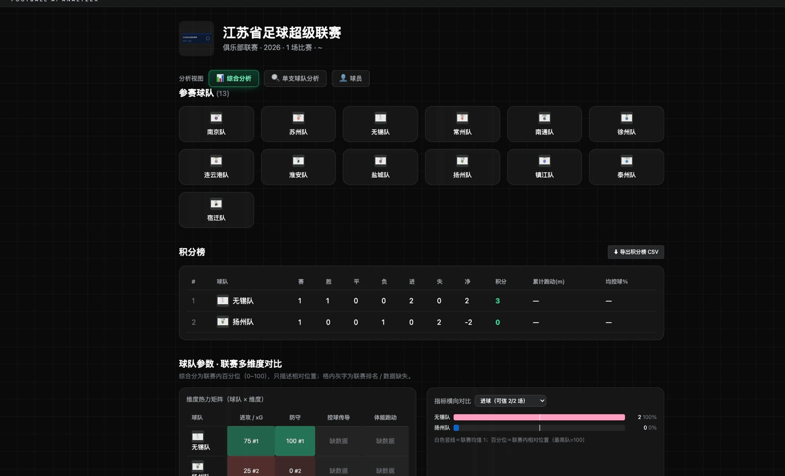 |
| **中英双语报告，结论可回跳帧** | **覆盖 13 支球队的联赛专辑** |
| 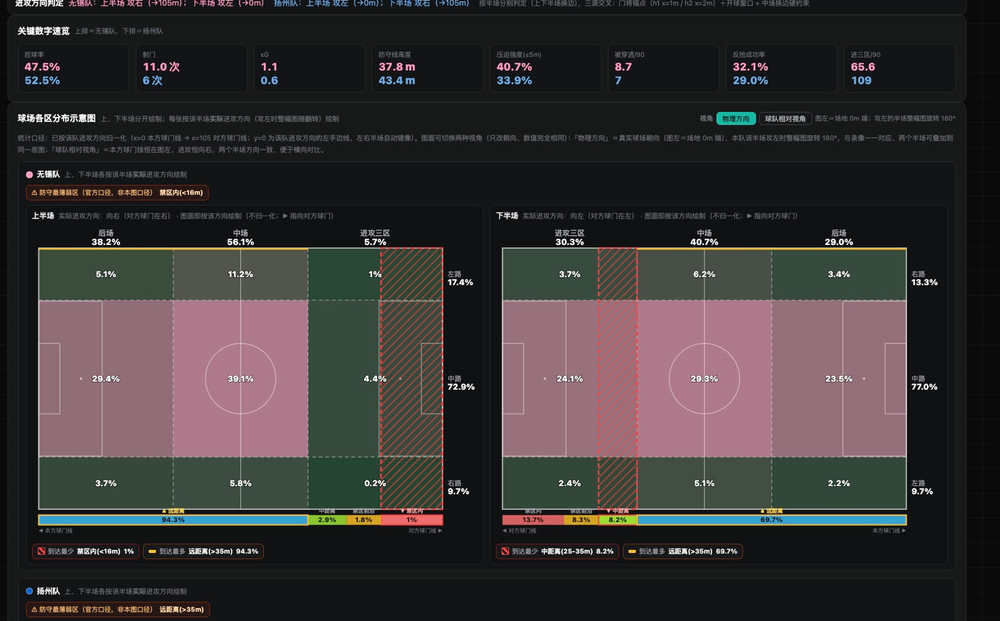 |  |
| **比赛摘要：一场比赛在一屏里** | **对抗与转换片段** |
| 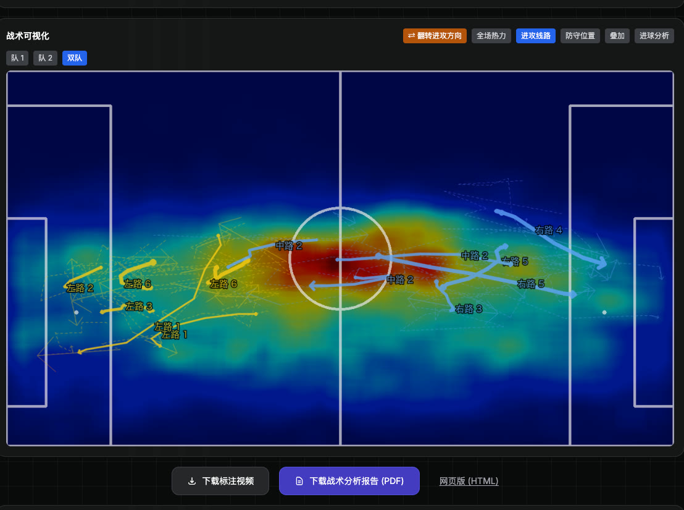 | 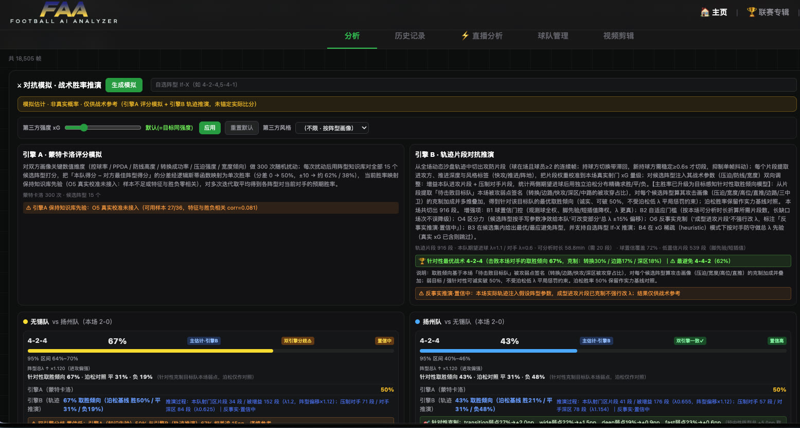 |
| **热区与进攻线路** | **双方对抗模拟推演** |

截图取自真实联赛的完整分析过程。若界面中出现内部配置面板，该面板已被裁掉，不予展示。

---

## 刻意排除的内容

给审查这个仓库的人一份明确清单：

- 任何形式的源码，包括构建脚本与内部工具；
- 模型权重、检查点、导出的计算图与推理引擎；
- 训练、验证、标注数据集；
- 说明球场配准、追踪、球队归属与战术识别具体实现的方法文档；
- 客户名称、合同、报价与任何商务条款；
- 服务器凭据、部署脚本与基础设施配置。

`docs/` 目录只描述**模块边界与评估标准**。它不涉及算法、参数或模型结构，并且会一直保持
这个原则。

---

## 如何评估

三条路径，深度递增。按你需要知道的程度选。

**1. 公开资料——零承诺。**
读站点和样本报告。报告里的每个数字都能追溯到某一帧；如果是模型推算而非实测得出的值，
文档里会标注出来。这种标注纪律本身，也是我们要请你判断的一部分。

**2. POC——一场比赛，48 小时。**
给一段比赛视频（你们自己的素材，或你有权使用的公开转播）。48 小时内拿到那场比赛的完整
产出，免费，限一场。文件带 `POC · 非生产用途` 水印，不得转发。报告归你，我们不留存。
这是最快的验证方式——能不能给你手上的教练、分析师或产品线用，一场就知道。

**3. NDA 之下——看方法。**
面向授权或受让尽调，我们会开一个**私有**仓库，内含实现，并向指定个人授予限时只读权限。
范围、时长与撤回方式在授权前书面约定。架构走查与精度讨论在同一次会话里完成——见
[docs/verification.md](docs/verification.md)。

---

## 两种商务轨道

两条线同时开放，且不互斥。

**使用权**——面向俱乐部、足协、联赛、转播方、媒体与青训机构：
席位授权（分析师工作站）、按场次分析服务，或白标 / API 接入已有平台。

**所有权**——面向体育数据公司、体育科技厂商、软件公司与投资机构：
整套资产的整体受让或独占许可，含源码、商标与客户合同。软件著作权登记正在办理，是交割
清单的一项；已登记软件著作权的转让，须在中国版权保护中心办理合同登记，这一步由我们在
交易中一并完成。

---

## 本仓库的版本记录

| 版本 | 日期 | 变更 |
|---|---|---|
| v1 | 2026-11 | 首版展示：能力集、界面实录、评估路径 |

这个仓库靠**证据**生长，不靠代码：样本报告、精度如何测量的方法说明，以及后续在 Releases
里放出的脱敏评估包。

---

## 联系方式

**魏巍（Allen Wei）**
电话 / 微信：**186 1678 4797**
邮箱：**907882691@qq.com**（主用）· jov611@gmail.com
站点：https://sportai-hq.pages.dev

请用公司邮箱联系，并说明你在问哪条轨道（使用权或所有权），这样第一封回复就是对的。

---

## 许可

保留所有权利，详见 [LICENSE](LICENSE)。允许阅读、引用并在内部评估本材料；不对任何实现、
模型或数据集授予许可——它们不在本仓库中。
